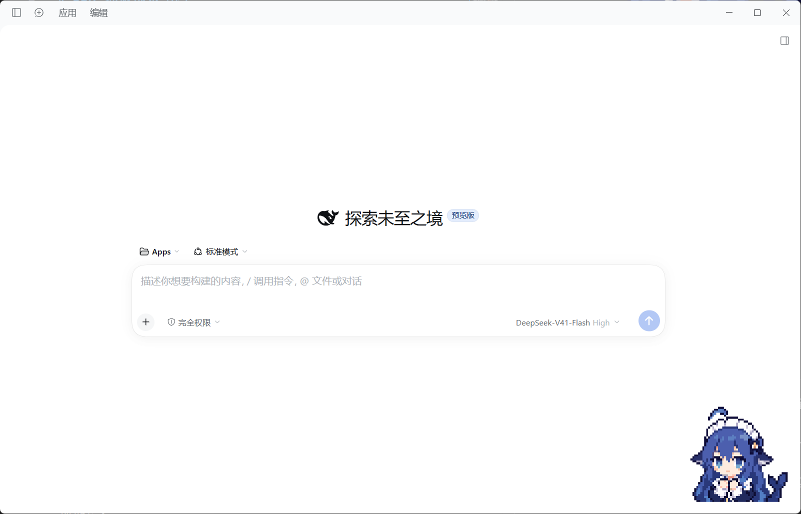

# DSH 鲸娘余额插件像素动画

为 DeepSeek Harness Web 与 Desktop 提供会随工作状态变化的鲸娘动画，并保留原余额挂件的记账、泡泡、音效和自定义角色功能。

- 本项目由 [MeteorNOX/DeepSeek-Balance-Whale-Widget](https://github.com/MeteorNOX/DeepSeek-Balance-Whale-Widget) 复刻
- 动画资源来自 [ccch1mneyyy/dsh-TUI](https://github.com/ccch1mneyyy/dsh-TUI)
- 原项目 README 原文请阅读 [README.upstream.md](README.upstream.md)；其中的旧版本安装命令对应原项目。
- 本分支的安装与维护以本页及 [安装指南](docs/INSTALL.md) 为准。




## 本分支的变化

- 22 个动作、267 帧原始透明 PNG，保留面部与服饰细节，并适配高 DPI 屏幕。
- 工作、输出、等待确认、压缩上下文及子代理状态驱动动画；支持按压、拖拽、入睡和唤醒。
- 默认角色直接播放像素动画，启动加载期间保持透明；资源加载失败可从菜单重试。
- 小黄鸭音效默认音量与“恢复默认”均为 20%；已保存的个人音量继续优先。
- 对话框默认使用阶梯像素边框与内置中文像素字体；菜单可切换“原框像素化”或“经典样式”。
- 自定义上传的角色、泡泡、账本与其它原有功能继续使用。完整行为见 [像素动画说明](docs/PIXEL.md)。

对话框效果：左侧为默认像素边框，右侧为原框缩小、颜色归一后生成的像素 SVG，保留深蓝描边、白色填充与透明背景。

 

## 下载与安装

维护者会在 [本仓库 Releases](https://github.com/EachYoungX/DeepSeek-Balance-Whale-Widget/releases) 发布带 `pixel` 的版本。Release 附件由维护者手动发布；GitHub 自动生成的 Source code 与经过打包校验的安装附件分别提供。

| 附件示例 | 用途 |
|---|---|
| `dsh-whale-widget-0.4.2-pixel.4.tgz` | 标准 DSH 插件安装包，交给包管理器安装 |
| `dsh-whale-pixel-0.4.2-pixel.4.zip` | 完整版本目录，适合 Desktop 本地 `link:` 安装或开发 |
| `SHA256SUMS.txt` | 对应附件的 SHA-256 校验值 |

**已经装了原余额挂件，也可以切换。** 本分支沿用包名和插件标识 `dsh-whale-widget`，用一个定制版本接替原包。通过当前 profile 的插件管理器移除旧包，再安装本分支；保留 `.dsh` 中的用户数据。具体步骤与回退方法见 [已有用户迁移](docs/INSTALL.md#已有原余额挂件)。

### DeepSeek Harness Desktop

将 ZIP 解压到固定的新目录，例如 `D:/DSHPlugins/dsh-whale-pixel/`，确认目录中有 `package.json`。在 Desktop 中使用官方插件管理器，或让当前会话的 `plugin_manager` 安装：

```text
link:D:/DSHPlugins/dsh-whale-pixel
```

安装目标是当前 Desktop profile。已安装同名包时，先通过管理器移除旧包；不要清理用户数据。完成后完全退出客户端（含托盘）再启动，核对菜单版本。已链接本工作目录的维护者直接重启即可。

### DSH Web

在退出使用该 profile 的 DSH 后，用下载的安装包替换原包：

```powershell
dsh plugin --profile web add "D:/Downloads/dsh-whale-widget-0.4.2-pixel.4.tgz"
```

本地开发可在源码目录运行 `dsh plugin --profile web add link:.`。Desktop 使用上面的专用步骤。

## 与已有插件兼容

| 已有功能 | 使用方式 |
|---|---|
| DSH 自带的账号与余额设置 | 继续保留，本挂件沿用原来的凭据解析方式 |
| 原版 `dsh-whale-widget` | 在同一 profile 中切换到本分支，保留账本与设置 |
| 其它包名的余额插件 | 保留其包；按需停用重复的悬浮显示，并分别核对数据口径 |

同名插件只安装一个版本。后续更新请继续选择本分支的 Release；切回官方版本会恢复官方代码。解压到一个新的版本目录再切换安装来源，能保留旧目录供回退，避免目录合并留下已经删除的素材。

## 来源、许可与贡献

- 余额挂件基线：`0.4.2`，提交 `5247dd6813d6e4430728f39ccc63d43cda046022`。
- 动画资源基线：dsh-TUI `0.16.1`，提交 `73ff99fbed56563bf154d719effd09f9f9725349`；资源哈希见 [upstream.lock.json](upstream.lock.json)。
- 原文档：[本地原文](README.upstream.md) · [上游固定版本](https://github.com/MeteorNOX/DeepSeek-Balance-Whale-Widget/blob/5247dd6813d6e4430728f39ccc63d43cda046022/README.md)。原文作为基线保存，后续分支说明写在本页和 `docs/`。
- 代码许可与素材说明：[LICENSE](LICENSE) · [NOTICE](NOTICE.md) · [PROVENANCE](PROVENANCE.md)。美术素材按来源声明保留其许可范围。
- 贡献与 AI 参与说明：[贡献者](docs/CONTRIBUTORS.md) · [贡献指南](CONTRIBUTING.md)。

## 维护与发行

```powershell
npm run check
npm run preview
npm run patches
npm run release:bundle
```

公开使用文档在 `docs/`，内部研究记录在忽略的 `internal_docs/`。全部 **29 个** `/dsh-whale/*` 路由沿用宿主信任校验。发行包的准备、验证与手动发布见 [发行说明](docs/RELEASING.md)。
